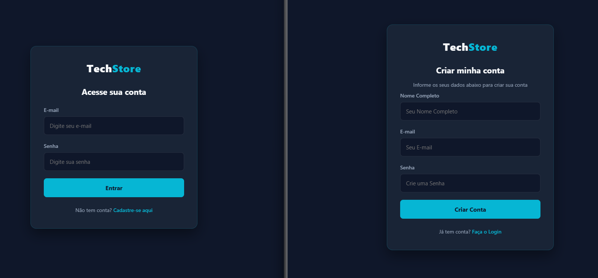
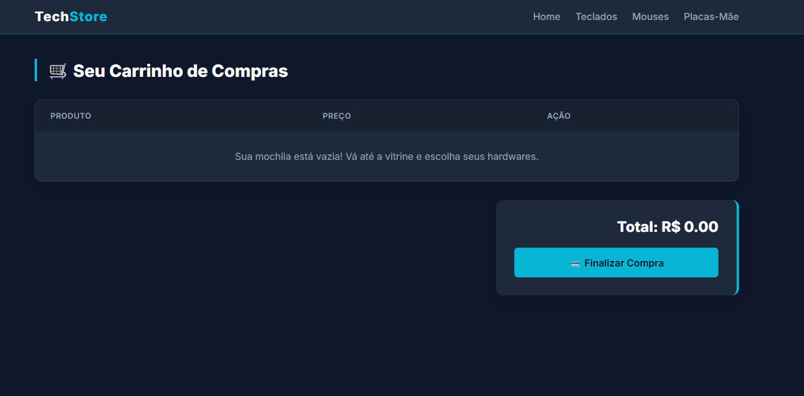
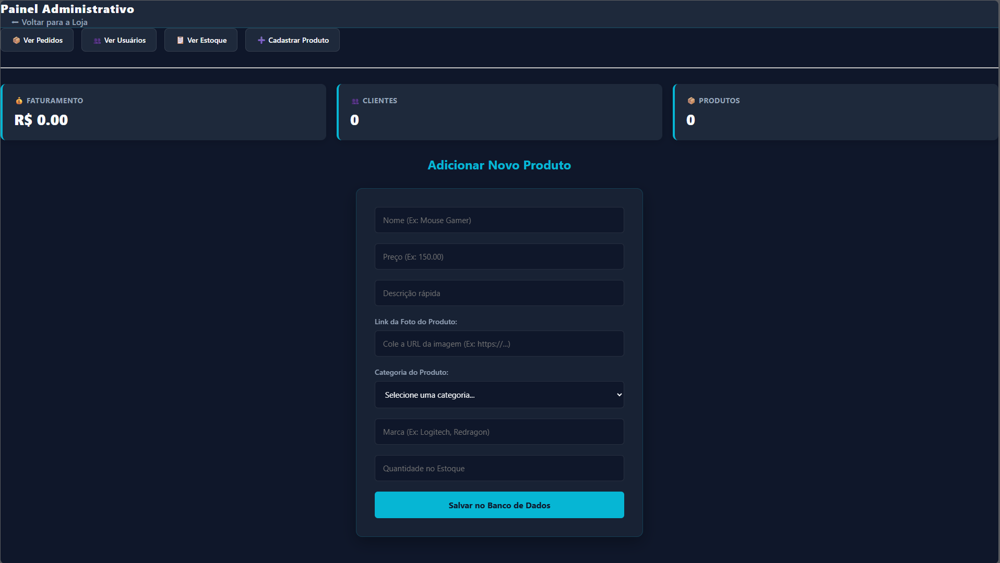

# 🛒 TechStore – Loja Virtual de Hardware

Loja virtual de hardware e periféricos desenvolvida como projeto da faculdade (Sistemas de Informação, UNIFACS). O cliente navega pelo catálogo, monta o carrinho e finaliza o pedido. O administrador gerencia produtos e acompanha usuários e pedidos em um painel próprio.

O sistema tem três partes: um front-end em HTML, CSS e JavaScript puro, uma API REST em Node.js com Express e um banco MySQL. Tudo sobe com um único comando usando Docker Compose.






## Funcionalidades

**Cliente**
- Vitrine com todos os produtos e filtro por categoria (teclado, mouse, monitor, headset, placa-mãe, placa de vídeo)
- Cadastro e login
- Carrinho de compras, guardado no `localStorage` do navegador
- Finalização da compra, que registra o pedido no banco

**Administrador**
- Painel com totais de clientes, produtos e faturamento
- Cadastro, edição e exclusão de produtos, incluindo a criação de novas categorias
- Listagem de usuários e de pedidos

## Tecnologias

| Camada | Tecnologia |
| --- | --- |
| Front-end | HTML5, CSS3, JavaScript (sem framework), servido pelo nginx |
| Back-end | Node.js 18, Express 5, mysql2, cors, dotenv |
| Banco de dados | MySQL 8.0 |
| Infraestrutura | Docker e Docker Compose |

## Como rodar

Pré-requisito: [Docker](https://www.docker.com/) com Docker Compose.

```bash
git clone https://github.com/cleitonrodri/Loja-Virtual-ProjetoFacul.git
cd Loja-Virtual-ProjetoFacul
docker compose up --build
```

O Compose sobe três containers. O servidor Node só inicia depois que o MySQL estiver saudável, e o `init.sql` cria as tabelas e cadastra os dados de exemplo na primeira execução.

| Serviço | Endereço |
| --- | --- |
| Loja (front-end) | http://localhost:8080 |
| API (back-end) | http://localhost:3000 |
| MySQL | `localhost:3307` |

Acesse a loja a partir da mesma máquina onde o Docker roda. O front-end chama a API em `http://localhost:3000`.

**Conta de teste (administrador):** `admin@techstore.com` / `123456`. Esta conta e os 10 produtos de exemplo vêm do `init.sql`. Para testar como cliente, use a página de cadastro.

As credenciais do `docker-compose.yml` (`root` / `root`) servem apenas para o ambiente local de desenvolvimento.

## Estrutura do projeto

```
.
├── backend/
│   ├── server.js              # sobe o servidor na porta 3000
│   └── src/
│       ├── app.js             # configuração do Express e das rotas
│       ├── db.js              # conexão com o MySQL
│       ├── routes/            # produtos, pedidos, usuarios
│       └── controllers/       # regras de cada rota
├── frontend/
│   ├── *.html                 # index, vitrine, carrinho, signin, signup, admin
│   ├── css/
│   └── js/
├── init.sql                   # tabelas e dados de exemplo
└── docker-compose.yml
```

## API

| Método | Rota | Função |
| --- | --- | --- |
| GET | `/produtos`, `/produtos/:id` | Lista ou busca produtos |
| POST, PUT, DELETE | `/produtos`, `/produtos/:id` | Cria, atualiza e remove produtos |
| POST | `/usuarios` | Cadastra usuário |
| GET, PUT, DELETE | `/usuarios`, `/usuarios/:id` | Lista, atualiza e remove usuários |
| POST | `/login` | Autentica e devolve id, nome e tipo |
| POST | `/pedidos` | Cria um pedido |
| POST | `/pedidos/:pedido_id/itens` | Adiciona um item ao pedido e atualiza o total |
| GET | `/pedidos`, `/pedidos/:id` | Lista pedidos ou busca um pedido com seus itens |

## Banco de dados

Quatro tabelas: `usuarios`, `produtos`, `pedidos` e `itens_pedido`. Cada pedido pertence a um usuário, e cada item liga um pedido a um produto com quantidade e preço. O esquema completo está em [`init.sql`](init.sql).

## Limitações conhecidas

Este é um projeto acadêmico, e estes pontos ficaram de fora do escopo:

- As senhas são guardadas em texto puro, sem hash.
- Não há token de sessão. O acesso ao painel admin é verificado só no navegador, e as rotas da API não exigem autenticação.
- O fluxo de compra grava apenas o total do pedido. A rota que registra os itens existe, mas o carrinho ainda não a chama, e o estoque não é baixado ao comprar.
- A URL da API está fixa em `http://localhost:3000` nos arquivos do front-end.
- Não há testes automatizados.

## Próximos passos

1. Guardar senhas com hash (bcrypt) e autenticar com JWT.
2. Registrar os itens de cada pedido e baixar o estoque na finalização da compra.
3. Mover a URL da API para uma configuração e proteger as rotas de administrador no back-end.
4. Adicionar testes para as rotas principais.

## Autores

Projeto desenvolvido em dupla. Todas as etapas (banco de dados, API, front-end e Docker) foram feitas em conjunto, sem divisão de tarefas.

- **Cleiton Rodrigues** – [GitHub](https://github.com/cleitonrodri) · [LinkedIn](https://www.linkedin.com/in/cleiton-rodrigues-ti/)
- **Leonardo** – [GitHub](https://github.com/leoxsantos)
